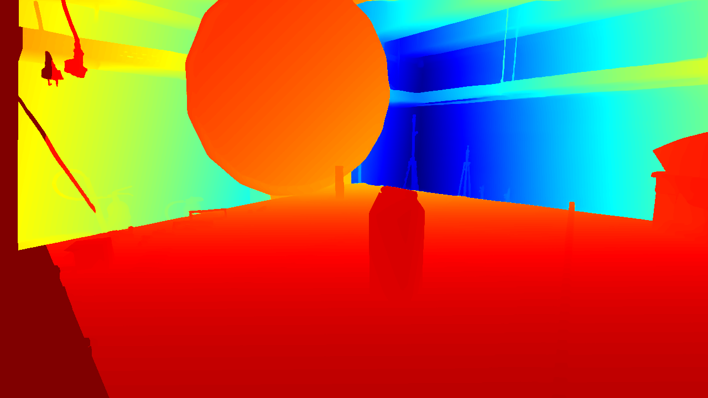
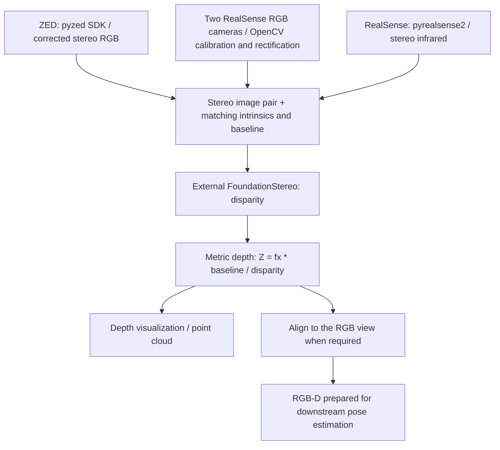

# Stereo Vision and Depth Pipelines for Industrial Robotics

[Personal website](https://alex7537.github.io/) · [ZED capture](pipelines/zed_rgb/zed-rgb.py) · [RealSense alignment](pipelines/realsense_ir/fs_depth_to_rgb_alignment.py)

This repository connects camera acquisition and calibration to stereo depth estimation and RGB-D preparation for industrial 6D object pose pipelines. It consolidates dual-RGB and ZED workflows, with an additional RealSense infrared-to-color alignment route.

**The engineering work is in the camera/data integration:** collecting stereo inputs, keeping calibration consistent with the images, converting depth into usable RGB-D and point-cloud artifacts, and preserving representative samples. FoundationStereo and the downstream pose model are external model dependencies.

## Example output



A stored false-color depth visualization from the ZED alignment checks. [Left RGB sample](samples/zed_capture/left_000004.png) · [Right RGB sample](samples/zed_capture/right_000004.png) · [Alignment overlay](samples/zed_alignment_check/align_overlay.png). These are qualitative samples, not a quantitative depth or pose-accuracy benchmark.

## Pipeline at a glance



For ZED, the capture script retrieves SDK-rectified left/right images and their corresponding calibration, with SDK depth computation disabled. The RealSense route also captures native device depth for a separate SDK-based path.

## Main components and outputs

| Route | Software / method | Output |
|---|---|---|
| Two-device RGB stereo | RealSense SDK for capture; OpenCV checkerboard calibration and stereo rectification | Rectified RGB pair; intrinsics, stereo transform, and baseline |
| ZED RGB stereo | ZED SDK Python API (`pyzed.sl`) | Rectified left/right PNGs and `K_rgb_fs.txt` |
| RealSense IR helper | RealSense SDK (`pyrealsense2`); IR-to-RGB projection using calibration | IR pair, RGB, native aligned depth, and calibration JSON; custom-depth alignment and colored point-cloud tools |
| External stereo model | FoundationStereo: image pair → disparity → metric depth | `depth_meter.npy` and point-cloud artifacts |
| Downstream pose stage | FoundationPose integration direction: RGB + aligned depth + intrinsics + mask + object mesh | Object rotation and translation, handled outside the capture scripts |

The current repository provides capture and processing scripts plus integration examples; it is not a single automated end-to-end pose benchmark. A saved visualization should not be interpreted as validated pose accuracy.

## Implementation reference

Unified stereo workflow for your two main routes:

- dual RGB cameras
- ZED stereo RGB

RealSense IR support is kept as a secondary helper pipeline, not the main project identity.

## What this repo contains

```text
pipelines/
  dual_rgb/
    RGB-pipeline/
  zed_rgb/
  realsense_ir/
tools/
  zed_depth/
samples/
references/
```

## Main routes

### 1. Dual RGB

Use:

- `pipelines/dual_rgb/RGB-pipeline/save_calib_images_dual_rgb.py`
- `pipelines/dual_rgb/RGB-pipeline/stereo_calibrate_rgb.py`
- `pipelines/dual_rgb/RGB-pipeline/make_fs_intrinsic_from_npz.py`
- `pipelines/dual_rgb/RGB-pipeline/capture_rectified_for_fs.py`

Outputs are written to:

- `outputs/dual_rgb/`

### 2. ZED RGB

Use:

- `pipelines/zed_rgb/zed-rgb.py`
- `tools/zed_depth/npy_png.py`
- `tools/zed_depth/depth_compare.py`
- `tools/zed_depth/depth_uberprufen.py`

Outputs are written to:

- `outputs/zed_capture/`
- `outputs/zed_depth/`

### 3. RealSense IR helper path

Use only when you need IR-to-RGB aligned depth:

- `pipelines/realsense_ir/realsense_IR_v1.py`
- `pipelines/realsense_ir/IR-RGB-clp.py`
- `pipelines/realsense_ir/IR_farben.py`
- `pipelines/realsense_ir/fs_depth_to_rgb_alignment.py`

Outputs are written to:

- `outputs/realsense_ir/`

## Why this is the main repo now

- `pipeline-RGB` had the cleanest dual-RGB calibration flow
- `ZED` had the cleanest direct stereo capture flow
- `foundationstereo-industrial-6dpose` and `match` were mostly duplicated integration snapshots
- `FoundationStereo_copy` should stay external as the upstream model dependency

## Cleanup already done

- removed repeated calibration failure folders
- removed repeated visualization copies
- reduced sample and pose data to minimal representative examples
- replaced old absolute paths with repo-relative output paths
- added `outputs/` to `.gitignore`

## Recommended archive/delete plan

- delete or archive `test`
- delete or archive `test1`
- delete the empty `foundationpose`
- archive `match` after final spot-check
- archive `foundationstereo-industrial-6dpose` after you fully switch to this repo
