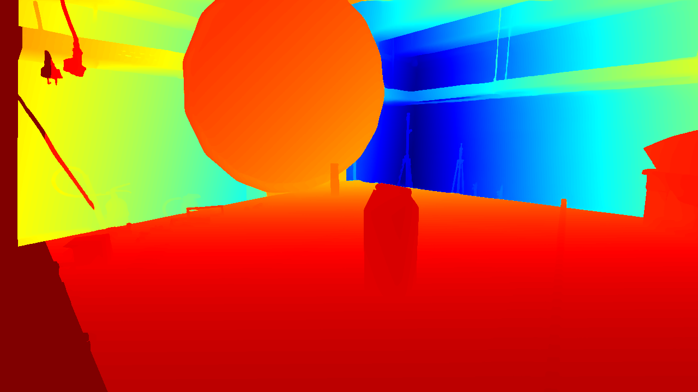
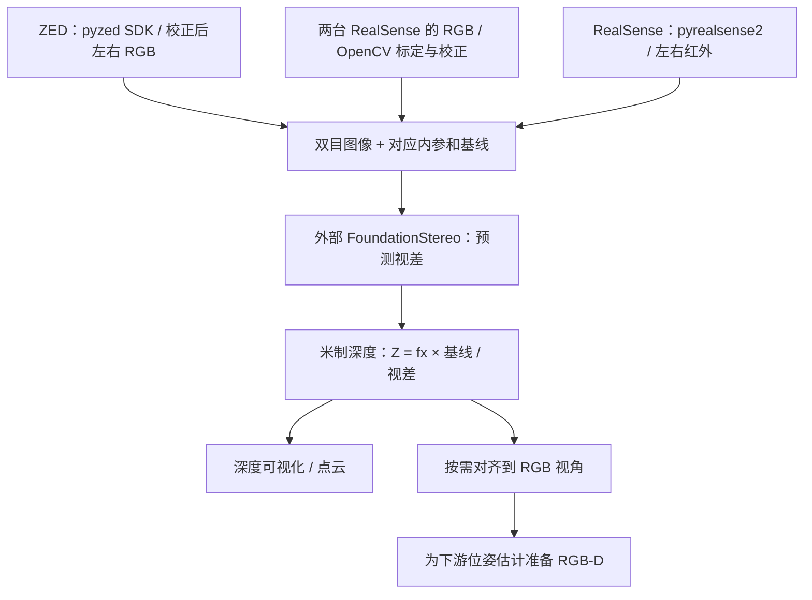

# 工业机器人双目视觉与深度处理管线

[English](README.md) | **简体中文**

[个人网站](https://alex7537.github.io/) · [ZED 采图](pipelines/zed_rgb/zed-rgb.py) · [RealSense 深度对齐](pipelines/realsense_ir/fs_depth_to_rgb_alignment.py)

本仓库连接相机采集、标定、双目深度估计与 RGB-D 数据准备，为工业 6D 物体位姿管线提供输入。主要整合两台 RGB 相机与 ZED 双目 RGB 两条路线，另保留 RealSense 红外深度到彩色图的对齐工具。

**本项目的工程工作是相机和数据集成**：采集双目输入，使图像与标定参数一致，将深度转为可用的 RGB-D 和点云产物，并保存代表性样例。FoundationStereo 与下游位姿模型是外部依赖。

## 输出样例



这是 ZED 对齐检查中保存的伪彩色深度可视化。[左目 RGB 样例](samples/zed_capture/left_000004.png) · [右目 RGB 样例](samples/zed_capture/right_000004.png) · [对齐叠加图](samples/zed_alignment_check/align_overlay.png)。

这些样例用于定性检查，不是深度或位姿精度的定量基准。

## 整体管线



ZED 采集脚本读取 SDK 校正后的左右图及对应标定参数，并关闭 SDK 原生深度计算。RealSense 同时采集设备原生深度，作为独立的 SDK 深度路线。

## 软件、模型与输出

| 路线 | 使用的软件或方法 | 输出 |
|---|---|---|
| 两设备 RGB 双目 | RealSense SDK 采集；OpenCV 棋盘格标定与立体校正 | 校正后的左右 RGB、内参、相对位姿和基线 |
| ZED RGB 双目 | ZED SDK 的 Python API：`pyzed.sl` | 左右 PNG、`K_rgb_fs.txt` |
| RealSense IR 辅助路线 | `pyrealsense2`；利用内外参将红外深度投影到 RGB | 红外图对、RGB、原生对齐深度、标定 JSON、自定义深度对齐和彩色点云工具 |
| 外部双目模型 | FoundationStereo：图像对 → 视差 → 米制深度 | `depth_meter.npy`、点云等 |
| 下游位姿阶段 | FoundationPose 集成方向：RGB、对齐深度、内参、Mask、物体 Mesh | 物体旋转和平移；不由采图脚本直接完成 |

本仓库包含采集、处理脚本和集成样例，尚不是单命令运行的完整位姿评测系统。保存的可视化不能视为已验证的位姿精度。

## 目录与使用入口

```text
pipelines/
  dual_rgb/RGB-pipeline/  两台 RGB 相机的采集、标定、校正
  zed_rgb/               ZED 双目 RGB 采集
  realsense_ir/          RealSense 红外、原生深度与 RGB 对齐
tools/zed_depth/         深度转换与可视化
samples/                代表性样例
references/             位姿集成参考数据
```

### 两台 RGB 相机

按采集标定图、标定、导出模型参数、采集校正图的顺序阅读：

1. [save_calib_images_dual_rgb.py](pipelines/dual_rgb/RGB-pipeline/save_calib_images_dual_rgb.py)
2. [stereo_calibrate_rgb.py](pipelines/dual_rgb/RGB-pipeline/stereo_calibrate_rgb.py)
3. [make_fs_intrinsic_from_npz.py](pipelines/dual_rgb/RGB-pipeline/make_fs_intrinsic_from_npz.py)
4. [capture_rectified_for_fs.py](pipelines/dual_rgb/RGB-pipeline/capture_rectified_for_fs.py)

输出目录：`outputs/dual_rgb/`。

### ZED RGB

- [zed-rgb.py](pipelines/zed_rgb/zed-rgb.py)：采集左右图与标定参数。
- [npy_png.py](tools/zed_depth/npy_png.py)、[depth_compare.py](tools/zed_depth/depth_compare.py)、[depth_uberprufen.py](tools/zed_depth/depth_uberprufen.py)：后续深度转换、可视化与检查。

输出目录：`outputs/zed_capture/`、`outputs/zed_depth/`。FoundationStereo 推理在外部模型仓库运行。

### RealSense 红外辅助路线

- [realsense_IR_v1.py](pipelines/realsense_ir/realsense_IR_v1.py)：采集 RGB、红外、原生深度及标定。
- [IR-RGB-clp.py](pipelines/realsense_ir/IR-RGB-clp.py)、[IR_farben.py](pipelines/realsense_ir/IR_farben.py)：将模型深度投影到 RGB，并生成彩色点云等产物。
- [fs_depth_to_rgb_alignment.py](pipelines/realsense_ir/fs_depth_to_rgb_alignment.py)：标定导出与 FoundationStereo 深度到 RGB 的对齐入口。

输出目录：`outputs/realsense_ir/`。这是一条按需使用的辅助路线。

## 仓库整合背景

`pipeline-RGB` 提供双 RGB 标定流程，`ZED` 提供双目采集流程；`foundationstereo-industrial-6dpose` 和 `match` 主要是重复集成快照。`FoundationStereo_copy` 作为上游模型依赖保留在外部。来源记录见 [merge-sources.md（英文）](docs/merge-sources.md)。

已清理重复标定失败目录和可视化副本，减少样例数据，改用仓库相对输出路径，并将 `outputs/` 加入忽略规则。

英文记录中的归档/删除条目是后续整理建议，不表示这些操作已执行。历史建议涉及 `test`、`test1`、空的 `foundationpose`，以及切换到本仓库后可归档的重复快照。

## 阅读与复现边界

本页提供主要技术链路和脚本入口；部分源码注释与历史参考文件仍为中文或德文。实际运行前仍需准备对应相机、官方 SDK、模型权重和匹配的环境配置。没有提供的相机或模型产物，不应被当作可直接复现的完整环境。
